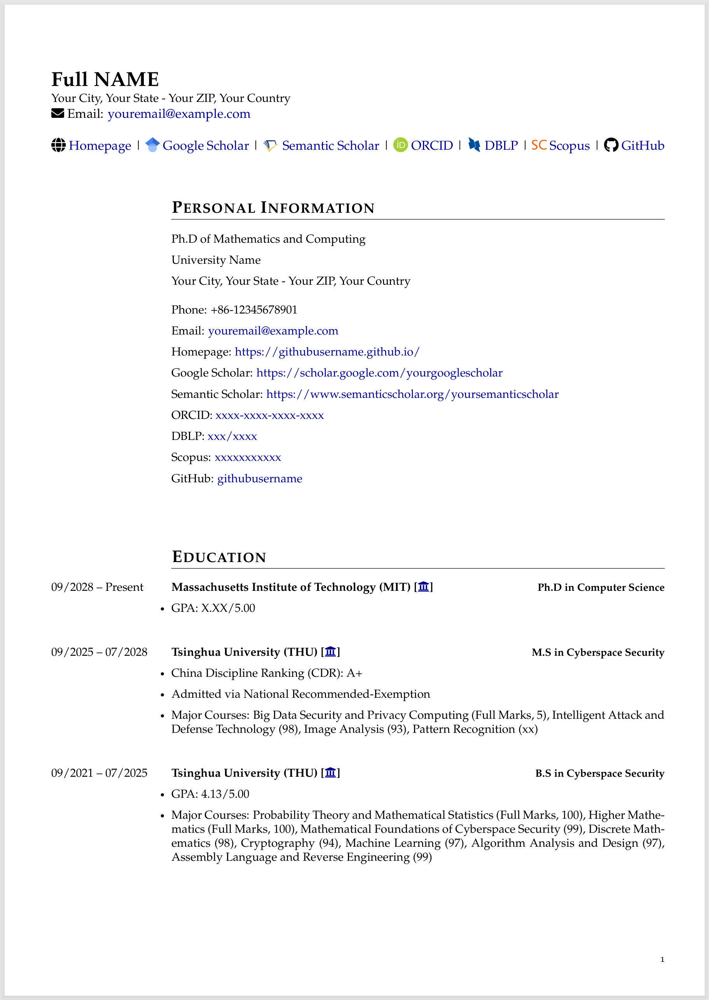
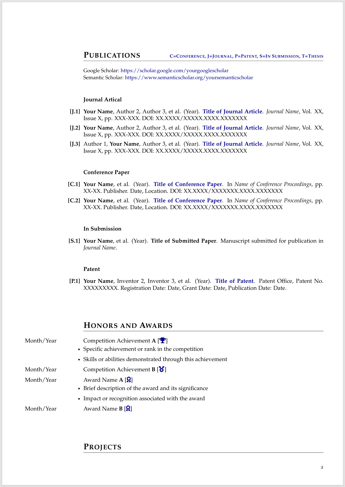
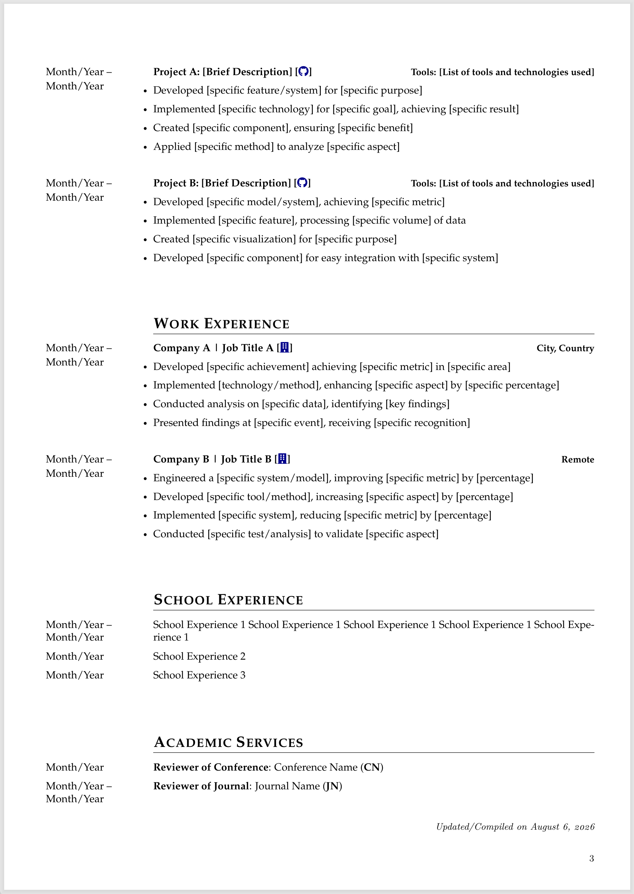
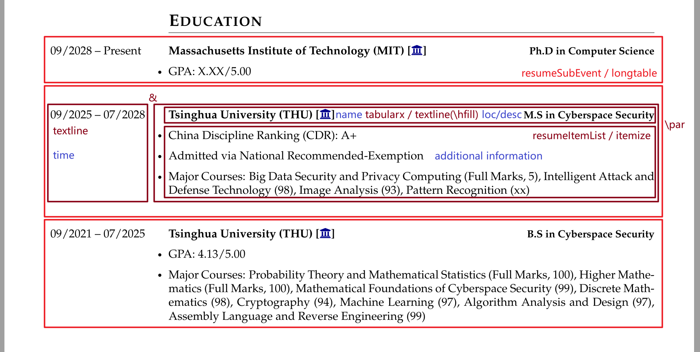
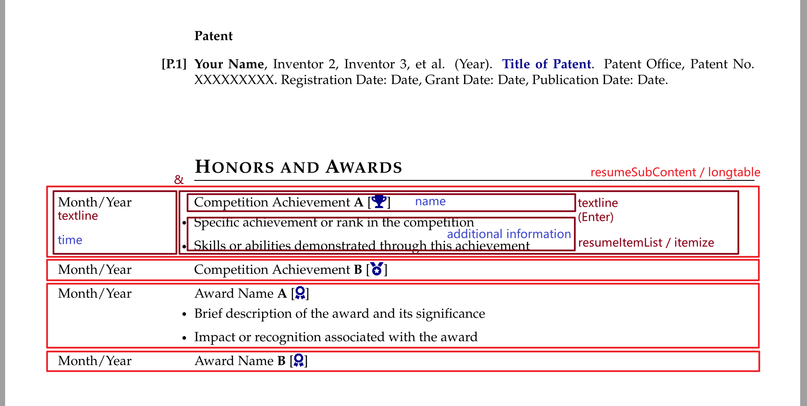

# Academic CV Template

[](README.md)

## 页面预览

<div style="display: flex; justify-content: space-between; align-items: flex-end;">
    
    
    
</div>

## 所需文件

```
./
|--figure	# store image here
|--sec		# cv sections here
|--main.tex	# Edit cv here
```

## 编辑内容

在 `main.tex` 导言区中编辑个人基本信息，作为头部内容；在 `sec/` 目录下编辑不同 `.tex` 文件，作为对应的章节内容。

### 标题选项

提供了不同的标题内容风格选项：

```latex
\rulestyleitrue
\rulestyleiitrue
```

同时，配合下面命令也可以排版不同风格的标题：

```latex
\section{}
\cvsection{}
```

注意：有且仅有一个 `\rulestyle` 被设置为 `true` (比如 `\rulestyleitrue`)

### 字体选项

提供了不同的字体选项，建议在 `\begin{document}` 下一行使用下面命令之一：

```latex
\fontstylei		% Helvetica-like (similar to Arial/Calibri)
\fontstyleii	% Times-like (similar to Times New Roman)
\fontstyleiii	% Palatino (elegant serif)
\fontstyleiv	% Bookman (readable serif)
\fontstylev		% Avant Garde-like (similar to Trebuchet MS)
\fontstylevi	% Quasi-Helvetica (another Arial/Calibri alternative)
\fontstylevii	% Quasi-Times (another Times New Roman alternative)
\fontstyleviii	% Quasi-Palatino (another elegant serif option)
\fontstyleix	% Computer Modern Roman
\fontstylex		% Computer Modern Sans Serif
\fontstylexi	% Charter (clean serif font)
```

### 对齐选项

针对时间列（左列）提供了三种对齐方式：

```latex
\timejtrue		% justify
\timeltrue		% left-align
\timertrue		% right-align
```


## 编辑模板

### 头部内容

在 `sec/head.tex` 文件中可以自主编辑模板：

- 设置图标（icon）
- 设置字号
- 设置展示的信息内容并排版
- ......

### 章节内容

设置不同的章节目的是为了以分类的形式来展示更为详细的事迹。描述一条事迹，需要包含这些元素：时间、名称、描述或地点（可选）、补充信息（可选）。不同类别的事迹对元素的需求不同，元素需求场景可能分为以下几种：

- 所有元素
- 只需要名称和时间
- 只需要名称、时间和补充信息

使用 `longtable` 表格环境排版所有内容，针对不同的场景分别定义了 `resumeSubEvent` 和 `resumeSubContent` 环境。前者需要接收四个参数且使用时用于一个环境排版一条事迹；后者无需传参，使用时用于一个环境排版所有事迹。在 `resumeSubEvent` 环境中使用一行两列的表格，让名称、描述或地点和补充信息放在一个单元格内，使用 `\par` 而不是 `\\` 来开始新的段落，这是因为在 `longtable` 表格环境中导致的，`\\` 会被视为结束表格行。两个环境都使用 `resumeItemList` 环境排版补充信息，它本质上是一个 `itemize` 列表环境。

```latex
% bullet point 1: All elements
\begin{resumeSubEvent}
  {time}
  {name}
  {loc/desc}
  {%
  \begin{resumeItemList}
    \item additional information 1
    \item additional information 2
  \end{resumeItemList}
  }%
\end{resumeSubEvent}
```

```latex
\begin{resumeSubContent}
  % bullet point 2: Just name and time
  {time} & {name}\\
  % bullet point 3: Just name, time, and additional information
  {time} & {name
  begin{resumeItemList}
    \item additional information 1
    \item additional information 2
  \end{resumeItemList}
  }\\
\end{resumeSubContent}
```





如果有其他的元素需求场景，上面的场景没有覆盖到，可以添加其他的模板命令。

### 控制对齐

对于左列内容，即时间列，提供了对齐方式的设置。而对于右列内容，只能使用默认的两端对齐。

```latex
\newif\iftimel\timelfalse % left-align
\newif\iftimer\timerfalse % right-align
\newif\iftimej\timejfalse % jusify
```

对于 `longtable` 中的内容，通过自定义的对其命令 `J/L/R` 实现不同的对齐方式。对于 `tabularx` 中的内容，通过 `X` 实现不同的对齐方式。对于左对齐和右对齐，它们本质上都是配合 `\raggedright` 和 `\raggedleft` 实现的。

```latex
\newcolumntype{J}{p{\leftcolwidth}}% justify
\newcolumntype{L}{>{\raggedright\arraybackslash}p{\leftcolwidth}}% left-align
\newcolumntype{R}{>{\raggedleft\arraybackslash}p{\leftcolwidth}}% right-align
```

```latex
X % justify
>{\raggedright\arraybackslash}X % left-align
```

### 控制 vspace

上面提到，对于 `resumeSubEvent` 环境，一个环境排版一条事迹；对于 `resumeSubContent` 环境，一个环境排版所有事迹。所以在 `resumeSubContent` 环境中，如果使用默认的行间距，会让不同的事迹非常紧凑。为了美观，建议使用 `\arraystretch` 命令将 `resumeSubContent` 环境中的行间距调大，为了缩小首行与标题的间距，通过 `\vspace` 命令将此间距调小：

```latex
{%
\renewcommand{\arraystretch}{1.5}
\vspace{-0.5ex}
\begin{longtable}.....
```

### 控制 hspace

上面提到，内容是一个 `longtable` 表格环境，因此为了实现表格左列文本的左边界与正文左边界对齐以及表格右列的右边界与正文右边界对齐，需要进行以下设置：

（1）固定左列的宽度，也是左列文本的宽度。

```latex
\newcommand{\leftcolwidth}{3cm}
```

（2）取消左列左侧的列间距和右列右侧的列间距：通过表格环境参数 `@{}` 实现该目的，需要将其放在左右两列。注意：为什么不设置 `\setlength{\tabcolsep}{0mm}` 列间距为0，是因为需要保留两列中间的两个列间距，让排版更美观，不至于让时间和名称太靠近。

```latex
\setlength{\tabcolsep}{3mm}
\begin{longtable}{@{}Lp{\dimexpr\linewidth-\leftcolwidth-2\tabcolsep-3\arrayrulewidth\relax}@{}}%
```

（3）将表格的框线粗细设置为0：有些列表环境即使不显示框线，框线依然会占用宽度。

```latex
\setlength{\arrayrulewidth}{0mm}
```

（4）自动计算右列的宽度：在水平方向上，占据空间的有2个列间距 `\tabcolsep`、3条框线粗细 `\arrayrulewidth` 和 左列的宽度 `\leftcolwidth`，在定义 `longtable` 环境时，自动计算右列的宽度为当前行宽减去上面这些宽度：

```latex
\linewidth-\leftcolwidth-2\tabcolsep-3\arrayrulewidth
```

## 中文支持

此模板目前不支持编译中文，但如果需要编译中文，需要做以下修改：

在导言区导入宏包就可以使用 `pdfLaTeX` 编译中文了：

```latex
\usepackage[UTF8]{ctex}
```

如果对英文无需求，可将下面内容注释掉：

```latex
%\usepackage[T1]{fontenc}
%\usepackage{cfr-lm}
...
%% FONT OPTIONS
%\newcommand{\fontstylei}{\fontfamily{phv}\selectfont} % Helvetica-like (similar to Arial/Calibri)
%\newcommand{\fontstyleii}{\fontfamily{ptm}\selectfont} % Times-like (similar to Times New Roman)
%\newcommand{\fontstyleiii}{\fontfamily{ppl}\selectfont} % Palatino (elegant serif)
%\newcommand{\fontstyleiv}{\fontfamily{pbk}\selectfont} % Bookman (readable serif)
%\newcommand{\fontstylev}{\fontfamily{pag}\selectfont} % Avant Garde-like (similar to Trebuchet MS)
%\newcommand{\fontstylevi}{\fontfamily{qhv}\selectfont} % Quasi-Helvetica (another Arial/Calibri alternative)
%\newcommand{\fontstylevii}{\fontfamily{qtm}\selectfont} % Quasi-Times (another Times New Roman alternative)
%\newcommand{\fontstyleviii}{\fontfamily{qpl}\selectfont} % Quasi-Palatino (another elegant serif option)
%\newcommand{\fontstyleix}{\fontfamily{cmr}\selectfont} % Computer Modern Roman
%\newcommand{\fontstylex}{\fontfamily{cmss}\selectfont} % Computer Modern Sans Serif
%\newcommand{\fontstylexi}{\fontfamily{bch}\selectfont} % Charter (clean serif font)
...
%\fontstyleiii
```

