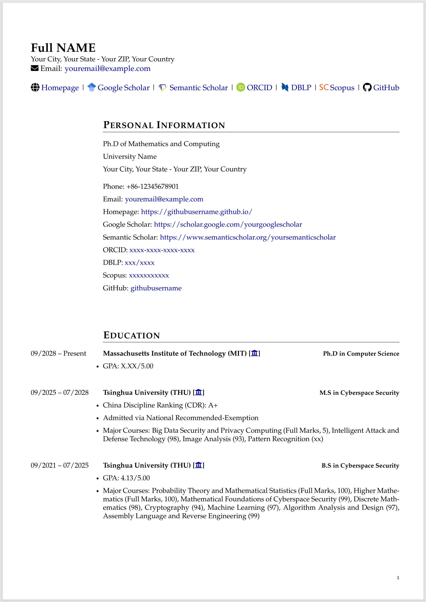
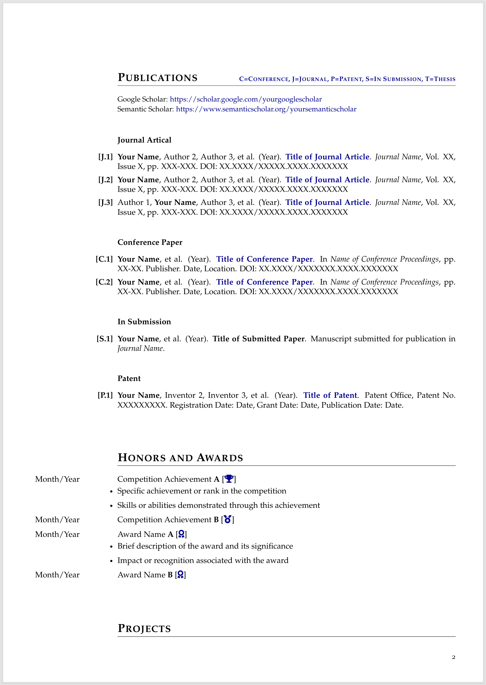
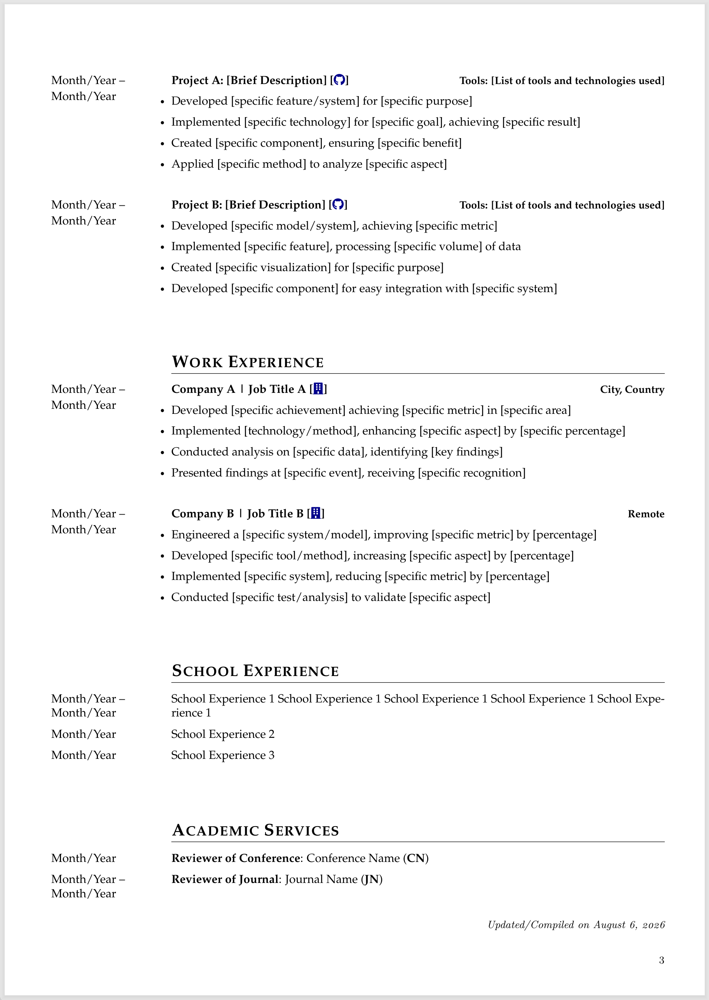
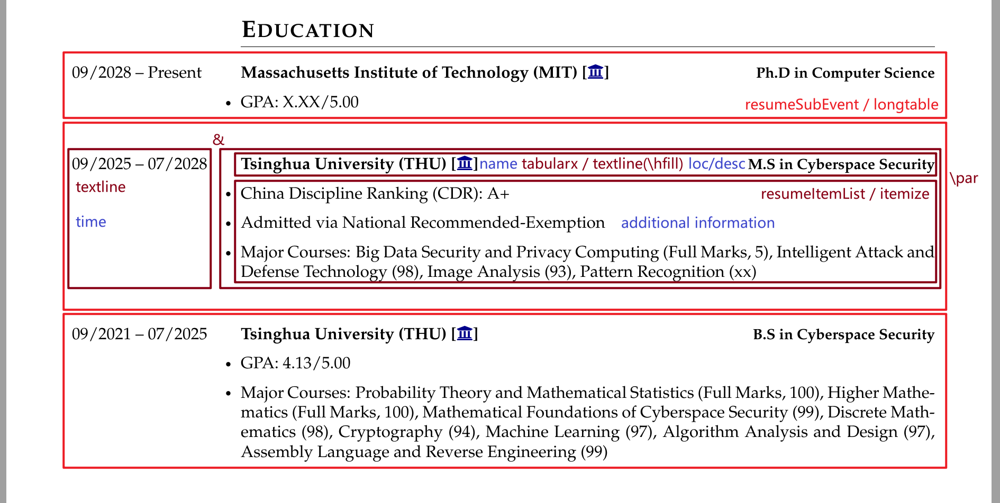
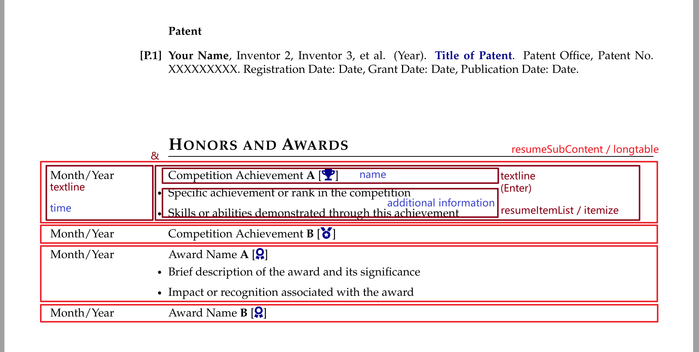

# Academic CV Template

[](README-zh.md)

## Overview: CV and Resume

Curricula vitae (CVs) are used to apply for teaching or research opportunities, fellowships, further academic training, grants, contract funding proposals, tenure, promotion to professor positions, and membership in a professional society or organization.

**Note**: In the United States, the term "resume" is used for industry and other non-academic positions. In some international settings, the term "CV" is used for all opportunities. However, you should tailor your document based on position type.

### CV vs. Resume

- CV: Comprehensive scholarly record; 2-3 pages for a graduate student, gets longer through a career.
- Resume: Brevity, relevance, efficiency; typically 1-2 pages (2 for PhDs or for those with more experience).

### Formatting CV

There is no single correct format or style for writing a CV – think about making it easy for your readers to skim and find the information they are looking for. Use a consistent format throughout, use an easy to read font, and make good use of descriptive section headings, subheadings, and white space to guide your reader.

Typically, CVs are longer than resumes. Unlike a resume, it is appropriate to describe both teaching and research experience in detail. If applying for a position that primarily involves research, describe research experience first; if the reverse is true, put teaching experience first. When describing your experience, include the goal, your contributions, and the impact/result of your contributions.

**Completeness is more important than brevity.** The length is typically 2 to 4 pages for a younger professional, 4 to 7 pages for a person with more experience.

### CV Headings

Headings can be located and titled strategically. Determine what is of primary importance, and put that section first.

- Name & Contact Information
- Education
- Research Interests
- Publications, including Journal Articles, Conference Papers, Books, Patents, and Manuscripts Under Review
- Posters
- Fellowships/Grants/Awards/Honors
- Professional Experience, e.g., Research Experience, Teaching Experience, Mentoring Experience, Industry Experience, Government Experience
- Leadership
- Service Activities, e.g., Academic Service, Professional Experience
- Presentations, or Invited Talks
- Skills – may include subcategories such as Computer, Languages, Lab Instrumentation
- References

## Preview

<div style="display: flex; justify-content: space-between; align-items: flex-end;">
    
    
    
</div>

## Required Files

```
./
|--figure	# store image here
|--sec		# cv sections here
|--main.tex	# Edit cv here
```

## Edit Content

Edit your personal basic information in the preamble of `main.tex` as the **header content**, and edit different `.tex` files in the `sec/` directory as the corresponding **section content**.

### Options for Section

Different section style options are provided:

```latex
\rulestyleitrue
\rulestyleiitrue
```

You can also use the following commands to format section in different styles:

```latex
\section{}
\cvsection{}
```

Please note: there must be **one and only one** `\rulestyle` set to `true` (e.g. `\rulestyleitrue`)

### Options for Font

Different font options are provided. It is recommended to use one of the following commands right after `\begin{document}`:

```latex
\fontstylei		% Helvetica-like (similar to Arial/Calibri)
\fontstyleii	% Times-like (similar to Times New Roman)
\fontstyleiii	% Palatino (elegant serif)
\fontstyleiv	% Bookman (readable serif)
\fontstylev		% Avant Garde-like (similar to Trebuchet MS)
\fontstylevi	% Quasi-Helvetica (another Arial/Calibri alternative)
\fontstylevii	% Quasi-Times (another Times New Roman alternative)
\fontstyleviii	% Quasi-Palatino (another elegant serif option)
\fontstyleix	% Computer Modern Roman
\fontstylex		% Computer Modern Sans Serif
\fontstylexi	% Charter (clean serif font)
```

### Options for Alignment

Three alignment options are provided for the **time column** (the left column):

```latex
\timejtrue		% justify
\timeltrue		% left-align
\timertrue		% right-align
```

## Edit Template

### Header Content

You can freely edit the template in the `sec/head.tex` file:

- Set icon
- Set font size
- Set the information to display and format it
- ......

### Section Content

The reason for setting up different sections is to display **bullet points** in a more detailed way through categorization. When describing a bullet point, it should include these elements: **time, name, description or location (optional), and additional information (optional)**. Different categories of bullet points have different requirements for these elements, and the **element requirement scenarios** may be divided into the following categories:

- All elements
- Just name and time
- Just name, time, and additional information

Use the `longtable` table environment to format all the content, and define the `resumeSubEvent` and `resumeSubContent` environments for different scenarios. The former takes four parameters and is used to format a single bullet point within one environment; the latter does not need any parameters and is used to format all bullet points within one environment. Inside the `resumeSubEvent` environment, a one-row-two-column table is used so that the name, description or location, and additional info are all placed in a single cell. Use `\par` instead of `\\` to start a new paragraph because in the `longtable` environment, `\\` is treated as the end of a table row. Both environments use the `resumeItemList` environment for formatting additional info, which is essentially an `itemize` list.

```latex
% bullet point 1: All elements
\begin{resumeSubEvent}
  {time}
  {name}
  {loc/desc}
  {%
  \begin{resumeItemList}
    \item additional information 1
    \item additional information 2
  \end{resumeItemList}
  }%
\end{resumeSubEvent}
```

```latex
\begin{resumeSubContent}
  % bullet point 2: Just name and time
  {time} & {name}\\
  % bullet point 3: Just name, time, and additional information
  {time} & {name
  begin{resumeItemList}
    \item additional information 1
    \item additional information 2
  \end{resumeItemList}
  }\\
\end{resumeSubContent}
```





If there are **other element requirement scenarios** that the above scenarios do not cover, you can add other template commands.

### Control Alignment

For the content in the **left column**, which is the time column, alignment settings are provided. But for the content in the right column, you can only use the default **justify**.

```latex
\newif\iftimel\timelfalse % left-align
\newif\iftimer\timerfalse % right-align
\newif\iftimej\timejfalse % jusify
```

For content in `longtable`, different alignments can be achieved using custom alignment commands `J/L/R`. For content in `tabularx`, different alignments are achieved using `X`. Left and right alignment are essentially realized with `\raggedright` and `\raggedleft`.

```latex
\newcolumntype{J}{p{\leftcolwidth}}% justify
\newcolumntype{L}{>{\raggedright\arraybackslash}p{\leftcolwidth}}% left-align
\newcolumntype{R}{>{\raggedleft\arraybackslash}p{\leftcolwidth}}% right-align
```

```latex
X % justify
>{\raggedright\arraybackslash}X % left-align
```

### Control vspace

As mentioned above, in the `resumeSubEvent` environment, one environment should format one bullet point; For the `resumeSubContent` environment, one environment should format all bullet points. Therefore, in the `resumeSubContent` environment, using the default line spacing makes different bullet points very compact. For aesthetics, it is recommended to use the `\arraystretch` command to increase line spacing in the `resumeSubContent` environment. To reduce the distance between the first line and the title, use the `\vspace` command to reduce this spacing:

```latex
{%
\renewcommand{\arraystretch}{1.5}
\vspace{-0.5ex}
\begin{longtable}.....
```

### Control hspace

As mentioned above, the content is a `longtable` table environment, so to make the left edge of the table left column align with the left edge of the main text and the right edge of the table right column align with the right edge of the main text, you need to make the following settings:

(1) Fix the width of the **left column**, which is also the width of the text in the left column.

```latex
\newcommand{\leftcolwidth}{3cm}
```

(2) Remove the left margin `\tabcolsep` of the left column and the right margin `\tabcolsep` of the right column: Use the table environment parameter `@{}` to achieve this, placing them on the left and right columns. **Note**: Why not set the column spacing to 0 for `setlength{tabcolsep}{0mm}`? Because you need to keep the spacing between the two columns to make the layout more aesthetically pleasing and prevent time and name from being too close.

```latex
\setlength{\tabcolsep}{3mm}
\begin{longtable}{@{}Lp{\dimexpr\linewidth-\leftcolwidth-2\tabcolsep-3\arrayrulewidth\relax}@{}}%
```

(3) **Set the table border thickness to 0**: In some table environments, even when borders are not displayed, they still occupy space.

```latex
\setlength{\arrayrulewidth}{0mm}
```

(4) Automatically calculate the width of the **right column**: Horizontally, the space taken up includes 2 column spacings `\tabcolsep`, 3 border line thicknesses `\arrayrulewidth`, and the width of the left column `\leftcolwidth`. When defining the `longtable` environment, the width of the right column is automatically calculated as the current line width minus all these widths:

```latex
\linewidth-\leftcolwidth-2\tabcolsep-3\arrayrulewidth
```

## Chinese Support

This template currently does not support compiling Chinese, but if you need to compile Chinese, you need to make the following changes:

You can use `pdfLaTeX` to compile Chinese by just importing the package in the preamble:

```latex
\usepackage[UTF8]{ctex}
```

If you do not need English, you can just comment out the content below:

```latex
%\usepackage[T1]{fontenc}
%\usepackage{cfr-lm}
...
%% FONT OPTIONS
%\newcommand{\fontstylei}{\fontfamily{phv}\selectfont} % Helvetica-like (similar to Arial/Calibri)
%\newcommand{\fontstyleii}{\fontfamily{ptm}\selectfont} % Times-like (similar to Times New Roman)
%\newcommand{\fontstyleiii}{\fontfamily{ppl}\selectfont} % Palatino (elegant serif)
%\newcommand{\fontstyleiv}{\fontfamily{pbk}\selectfont} % Bookman (readable serif)
%\newcommand{\fontstylev}{\fontfamily{pag}\selectfont} % Avant Garde-like (similar to Trebuchet MS)
%\newcommand{\fontstylevi}{\fontfamily{qhv}\selectfont} % Quasi-Helvetica (another Arial/Calibri alternative)
%\newcommand{\fontstylevii}{\fontfamily{qtm}\selectfont} % Quasi-Times (another Times New Roman alternative)
%\newcommand{\fontstyleviii}{\fontfamily{qpl}\selectfont} % Quasi-Palatino (another elegant serif option)
%\newcommand{\fontstyleix}{\fontfamily{cmr}\selectfont} % Computer Modern Roman
%\newcommand{\fontstylex}{\fontfamily{cmss}\selectfont} % Computer Modern Sans Serif
%\newcommand{\fontstylexi}{\fontfamily{bch}\selectfont} % Charter (clean serif font)
...
%\fontstyleiii
```

