```
官网：https://www.latex-project.org/
教程：https://mirrors.cqu.edu.cn/CTAN/info/lshort/chinese/lshort-zh-cn.pdf
教程：https://www.latexstudio.net/LearnLaTeX/lesson/01.html
参考：https://latexref.xyz/dev/latex2e.pdf
参考：https://visualmatheditor.equatheque.net/doc/texbook.pdf
在线编辑器：https://www.overleaf.com/
在线编辑器：https://www.onlinelatex.com/home/
在线公式编辑：https://www.latexlive.com/
在线公式编辑：https://simpletex.cn/formula_editor
在线表格编辑：https://www.latex-tables.com/
在线表格编辑：https://www.tablesgenerator.com/
```

# 前言

**TeX 与 LaTeX：**（1）TeX（由 Donald E. Knuth 开发）是一个功能强大但语法底层的**排版引擎**，原始 TeX 语法非常底层难用，适合高级用户或极端定制需求。（2）LaTeX（由 Leslie Lamport 开发）是一种使用 TeX 程序作为排版引擎的**格式**，是建立在 TeX 上的**宏包系统**，本质上是用 TeX 写的一堆函数/命令。可以粗略地将 LaTeX 理解成是对 TeX 的一层封装，隐藏了 TeX 的复杂细节，简化了 TeX 的使用难度，旨在让用户专注于内容创作而非版式设计。（3）可以一句话理解为：TeX 是引擎，LaTeX 是封装，建立在 TeX 之上，是对 TeX 的宏命令封装，让排版变得更容易、更结构化。

**排版引擎：**程序/编译器，用于解释和执行源代码。（1）**TeX**：底层排版引擎，把 .tex 文件转成 .dvi 文件；（2）**pdfTeX** 与 pdfLaTeX：pdfTeX 是对原始 TeX 引擎的扩展，直接输出 PDF 文件，而不是 DVI；pdfLaTeX 基于 pdfTeX 引擎编译 .tex 文件中写的 LaTeX 语法，并直接输出 PDF 文件，这是目前最常用的 LaTeX **编译方式**，但不属于排版引擎；（3）**XeTeX** 与 XeLaTeX：XeTeX 支持 UTF-8 编码和对 TrueType/OpenType 字体的调用；当前较为方便的中文排版解决方案基于 XeLaTeX；（4）**LuaTeX** 与 LuaLaTeX：LuaTeX 在 pdfTeX 引擎基础上发展而来，除了支持 UTF-8 编码和对 TrueType/OpenType 字体的调用外，还支持通过 Lua 语言扩展 TeX 的功能；LuaLaTeX 编译命令下的中文排版支持需要借助 luatexja 宏包。

**pdfTeX 与 XeTeX、LuaTeX：**当下 pdfTeX 有两个可原生使用 Unicode 输入与现代字体的替代引擎：XeTeX 和 LuaTeX。对于 LaTeX 版本而言，这些引擎通常在你的编辑器中分别通过 xelatex 和 lualatex 调用。

**宏包系统：**宏包系统是一个由宏包集合、样式文件、文档类和文档组成的功能模块集合，通常为某类文档或排版任务提供统一风格和完整解决方案。其中，大多数宏包系统（如 AMS-LaTeX、CTeX）是构建在 LaTeX 上的，必须依赖 LaTeX 的命令结构，而少数（如 ConTeXt）是完全独立于 LaTeX 的排版系统。（1）**AMS-LaTeX**：包含 amsmath、amssymb、amsthm、amsfonts 等宏包，基于 LaTeX 实现（命令结构一致），用于数学论文排版；（2）**CTeX**：包含 ctex、xeCJK 等宏包，依赖 LaTeX，针对中文文档深度定制的 LaTeX 宏包系统；（3）**ConTeXt**：与 LaTeX 平行的独立排版系统，也是基于 TeX 开发的宏包系统。

**宏包与文档类：**宏包（package）与文档类（document class）均是宏包系统（package system）的构成单元。宏包的文件扩展为【\.sty】，使用语法【\\usepackage\{amsmath\}】；文档类的文件扩展为【\.cls】，使用语法【\\documentclass\{amsart\}】。

**宏包系统 ≠ 宏包集合：**以 AMS-LaTeX 宏包系统为例，它不只是包含 amsmath\.sty 和 amssymb\.sty 宏包集合，它还包括 amsart\.cls 和 amsbook\.cls 这些文档类。

**TeX 发行版（TeX distributions）：**LaTeX 本身不是一个独立的排版程序，而是一种建立在 TeX 排版系统之上的文档准备软件。TeX 发行版会打包所有构建一个完整 TeX 系统所需的各个部分（比如排版引擎和宏包系统等）。LaTeX 以及基于它构建的许多宏包（如 amsmath、graphicx、biblatex、ctex 等）已经成为所有主流 TeX 发行版（如 **TeX Live**、**MiKTeX**、**MacTeX** 等）的重要组成部分。

**TeX 发行版？还是 LaTeX 发行版？**实际上只有 TeX 发行版，并不存在单独的 LaTeX 发行版。LaTex 本身只是一个 TeX 的宏包系统，必须依附 TeX 引擎运行；所有主流的 TeX 发行版（如 TeX Live、MiKTeX、MacTeX 等）都默认包含了 LaTex 宏包系统；但在实际使用 TeX 发行版中，通常是在使用 LaTeX，而不是直接使用 TeX。

使用 LaTeX 需要包含两个部分：（1）TeX 发行版；（2）**文本编辑器**：LaTeX 文档只是纯文本文件，因此可以使用任何文本编辑器进行编辑。但是，使用专为 LaTeX 设计的编辑器将带来更多便利，因为它们往往会提供一键编译、内置 PDF 阅读器以及语法高亮等功能，TeX Live 和 MiKTeX 均自带一个编辑器。

**适用场景：**不是所见即所得（WYSIWYG, What You See Is What You Get），每次预览排版效果前都需要经过编译，适用于大篇幅排版的文档，比如学术论文写作、书籍著作等，平时的电子笔记使用Markdown、Word这些所见即所得的方式更合适。

# 安装

## TeX Live - 完整版，适合离线使用（推荐）

```
Version: TeX Live 2025
OS: Windows 10
```

下载安装程序（官网）：install-tl-windows\.exe

```
https://www.latex-project.org/
```

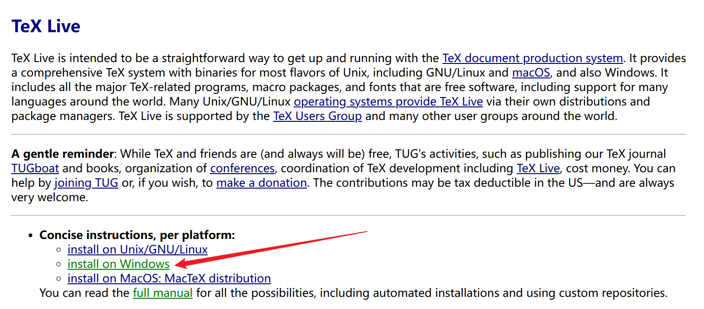

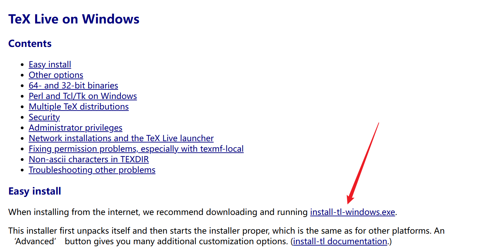

运行 install-tl-windows\.exe：

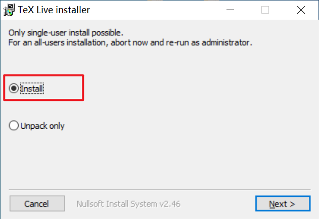

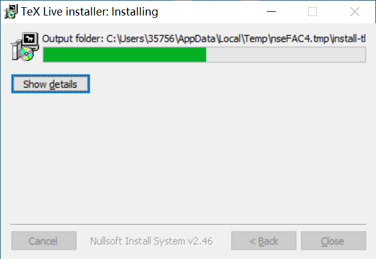

设置安装路径：

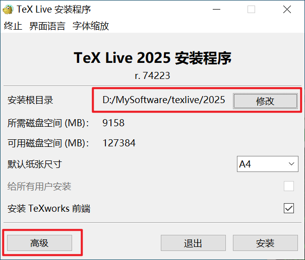

只选择中文和英文即可，减小安装大小，其他语言也用不到：

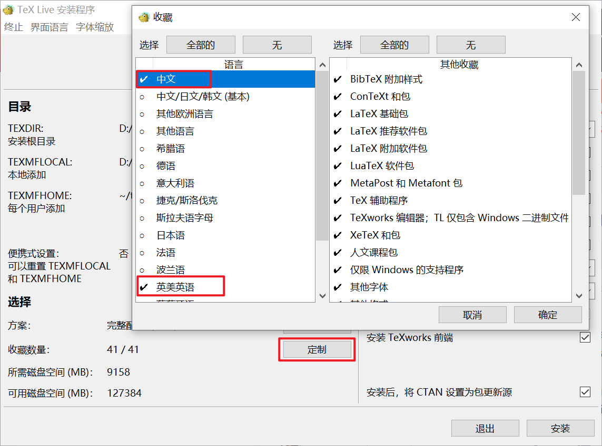

安装的过程太久了，但是卡在了【running package-specific postactions】：

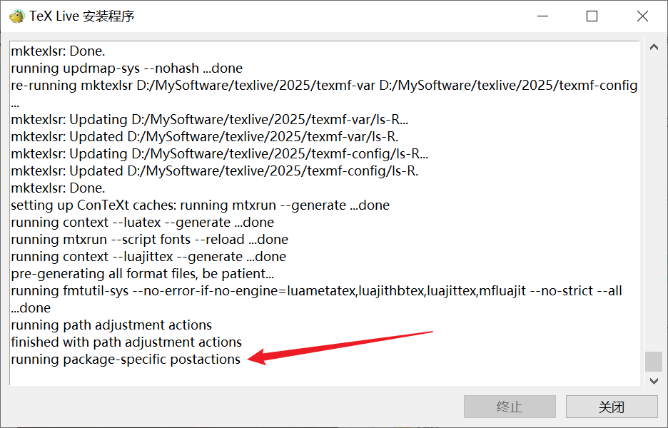

此时可能已经安装成功，这貌似是使用 GUI 安装 TeX Live 2025 的一个 BUG。确认是否安装成功：打开安装路径下的 \.log 日志文件【install\-tl\.log】，找到安装成功的标志：

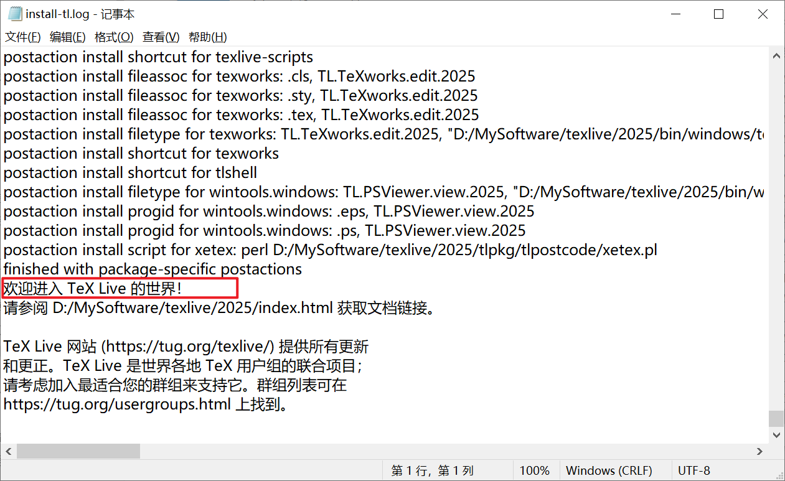

此时安装界面依然卡住，直接关闭即可。

测试是否安装成功：

```
latex -v
tex -v
```

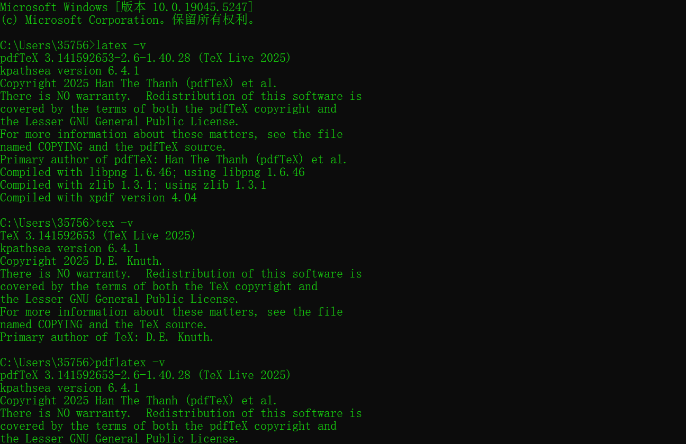

如果系统找不到命令，需要添加系统环境变量【安装目录\\bin\\windows】。

默认编辑器：TeXworks


## MiKTeX - 轻量版，按需下载缺失包

## VScode 环境配置

## TeXstudio 编辑器

下载安装包（texstudio\-4\.8\.7\-win）：

```
https://texstudio.sourceforge.net/
```

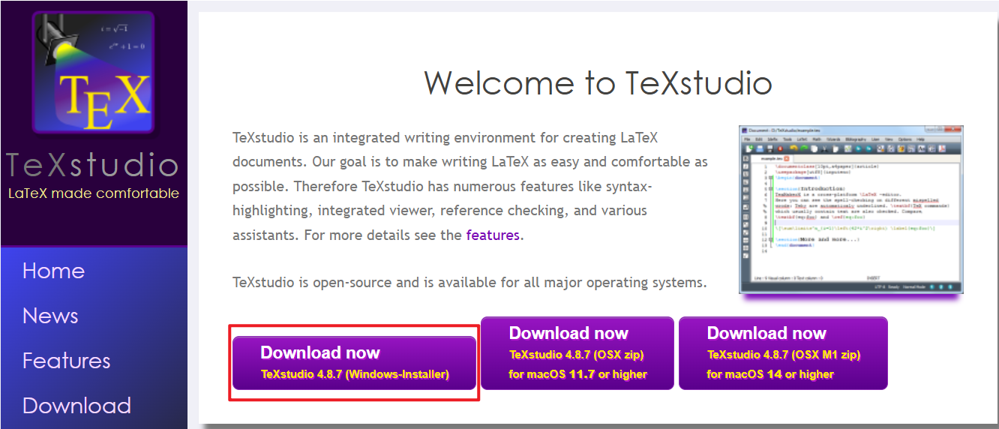

执行安装：

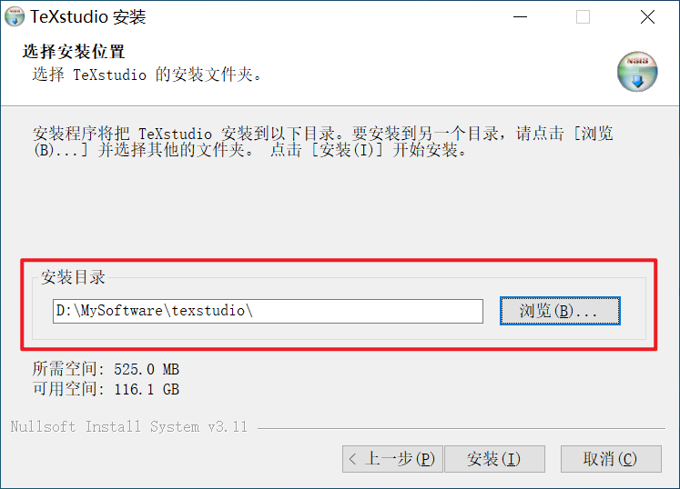

安装完成：

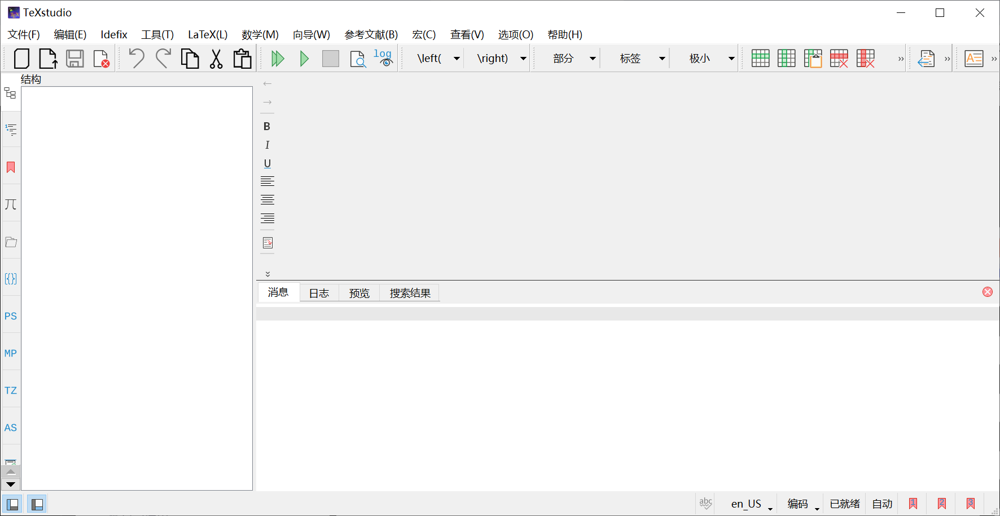

此时可以在【选项\-设置 TeXstudio】进行各种配置，一般默认即可。

# 前置知识

## 代码结构

```latex
\documentclass{...}	% ... 为某文档类
\usepackage{...}	% ... 为某宏包
% 导言区
\begin{document}
% 正文内容
\end{document}
% 此后内容会被忽略
```

## 控制序列

控制序列（Control Sequence）以反斜线 \\ 开头，有以下两种形式：

### 形式1: 控制词

控制词（Control Word）：【\\字母】

```latex
\LaTeX  \textbf{加粗内容}
```

必须以**空格**或**非字母字符**（标点、数字等）结束，后面不可以紧跟**字母**或**汉字**。否则会将紧跟的字母当成命令的一部分，后面紧跟汉字也会报错。

**空格：**命令后的所有空格都会被忽略掉；若要强制引入空格需要在命令后：（1）使用花括号【\{\}】强制命令结束，空参数；（2）转义字符【\\】后的第一个空格不会被忽略；（3）使用【\~】添加一个不允许换行的空格，缺点就是在引入空格的同时不允许其后的内容在行尾需要换行显示。

```latex
\LaTeXxxx		% 报错
\LaTeX xxx		% LaTeXxxx (命令后的空格被忽略)
\LaTeX{} xxx	% LaTeX xxx
\LaTeX\ xxx		% LaTeX xxx
\LaTeX~xxx		% LaTeX xxx

注意：当\LaTeX后跟中文时, 【\LaTeX 中文测试】好像就能输出一个空格效果, 导致手动添加一个空格的方式貌似与之没有区别. 该效果可能因为中英文混排导致的默认一个空格效果, 而不是这种文本命令遇到中文才导致的, 因为当使用【\textbackslash 中文测试】时空格效果就消失了, 当使用【\LaTeX~~中文测试】时可以手动添加两个空格.
```

```latex
a \textbf{b} c			% a b c (ps: b 和 c 中间有空格效果)
中 \textbf{文} 测试		% 中 文测试  (ps: 在中文排版中, "文"和"测"之间没有空格效果, 可能是因为中文没有分词习惯)
中 \textbf{文}{} 测试	% 中 文 测试 (ps: 可以使用 {}、\、~ 手动添加空格效果)
中 \textbf{文}\ 测试	% 中 文 测试
中 \textbf{文}~测试		% 中 文 测试
```

**非字母字符：**不包括汉字。

```latex
\LaTeX, great!	% LaTeX, great!
```

### 形式2: 控制符

控制符（Control Symbol）：【\\单个非字母符号】

```latex
\~  \^  \"  \=  等	% 在字母上添加变音符号 (带参数的命令)
\\  \#  \&  \$  等	% 换行或者打印特殊符号
```

主要关注添加变音符号的那些命令，因为它们会将紧跟其后的第一个字符视为它的参数，且只能用在单个字母上，无法用到多个字母上，如果想打印这些特殊符号，需要使用空花括号【\{\}】传递空参数：

```latex
\~{}	% ~
\^{}	% ^
```

注意：只能使用空花括号【\{\}】，不能使用【\\ 】或者【\~】。这是因为【\\\~】这类命令属于带参数命令，会尝试读取下一个字符作为参数，直到解析完；因此，【\\\~\\ 】或者【\\\~\~】会分别将【空格】和【第二个\~符号】当作【\\\~】命令的参数，这是不合法的；只能显示地告诉LaTeX【\\\~】命令没有参数，即使用一个空花括号【\{\}】传入空参数，才能成功打印变音符号。

## 中文排版

```latex
\documentclass{ctexart}
\begin{document}
在\LaTeX{}中排版中文。
汉字和English单词混排，通常不需要在中英文之间添加额外的空格。
当然，为了代码的可读性，加上汉字和 English 之间的空格也无妨。
汉字换行时不会引入多余的空格。
\end{document}
```

在 LaTeX 中排版中文。汉字和 English 单词混排，通常不需要在中英文之间添加额外的空格。当然，为了代码的可读性，加上汉字和 English 之间的空格也无妨。汉字换行时不会引入多余的空格。

## 空格处理 & 工作原理

LaTeX 源代码中会看到各种换行或者空格，但是在排版过程中是处理这些空格的？理解空格处理机制更有助于我们去编写源码。

（1）多个连续空白字符（由空格键或 Tab 键输入）视为一个空格；

（2）TeX 会忽略**控制词**（control word）后面的空格；

（3）TeX 会忽略**行首**的空格，以便可以在源代码中缩进，提高可读性；

（4）**行尾**的换行字符会当作空格处理，且多个空格会被合并为一个空格（可粗略理解为 TeX 会忽略行尾的空格）；

> In order to allow source code indentation, under normal circumstances, TEX ignores leading blanks in a line. 
>
> Reference：[《LATEX2e: An unofficial reference manual》](https://latexref.xyz/dev/latex2e.pdf)
>
> TEX is initially set up to treat \hreturni and \htabi the same as \ (control space);
>
> An input manuscript is expressed in terms of “lines,” but that these lines of input are essentially independent of the lines of output that will appear on the finished pages. Thus you can stop typing a line of input at any place that’s convenient for you, as you prepare or edit a file. A few other related rules have also been mentioned:
>
> - A \<return\> is like a space.
> - Two spaces in a row count as one space.
> - A blank line denotes the end of a paragraph.
>
> Strictly speaking, these rules are contradictory: A blank line is obtained by typing hreturni twice in a row, and this is different from typing two spaces in a row.
>
> The input to TEX is a sequence of “lines.” Whenever TEX is reading a line of text from a file, or a line of text that you entered directly on your terminal, the computer’s reading apparatus is in one of three so-called states:
> 	State *N*	Beginning a new line;
> 	State *M*	Middle of a line;
> 	State *S*	Skipping blanks.
> At the beginning of every line it’s in state *N*; but most of the time it’s in state *M*, and after a control word or a space it’s in state *S*.
>
> Reference：[《The TEXbook》](https://visualmatheditor.equatheque.net/doc/texbook.pdf)

**工作原理：**源代码中用“行”的方式来表达，但是这些输入的行和最后出现在页面中的行本质上是不同的。因此，在编辑源代码时，作者可以随心所欲地换行，但要明确几个规则：

（1）一个**换行符**与一个空格等价；

（2）一行中的两个**空格**视为一个；

（3）一个**空行**表示一段落的结束；

严格来说，这些规则有些矛盾：在一行内键入两次换行符就得到一个空行，而且这与在一行键入两个空格不同。

TeX 的输入是一系列的“行”，只要 TeX 从文件中读入一行文本，计算机的读入器就处在三个状态中的一个：

（1）在每行的开头，它处在状态 N：新行；

（2）大部分时间，它处在状态 M：行中间；

（3）在读入控制词或一个空格后，它处在状态 S：跳过空格。

## 运行步骤

### Step 1: 编写 \.TEX 文件

helloworld\.tex

```latex
\documentclass{article}
\begin{document}
``Hello world!'' from \LaTeX.
\end{document}
```

### Step 2: 编译

#### 2.1 使用编辑器

如果使用 TeXworks 或 TeXstudio 等编辑器，可以直接使用编辑器提供的“编译”按钮或者“排版”按钮。建议使用 pdfLaTeX 或 **XeLaTeX** 作为默认的编译方式。

#### 2.2 使用命令行

如果使用命令行进行编译，则需要在命令行中进入源代码所在的目录下，输入编译命令：

```cmd
pdflatex helloword
```

或者

```cmd
xelatex helloworld
```

如果编译成功，可以在 helloworld\.tex 所在目录看到生成的 helloworld\.pdf 以及一些其它文件。

### 编译方式的选择

上面提到两种推荐的编译方式：pdfLaTeX 和 XeLaTeX。如果在**排版中文**时，如下源代码，需要使用 **XeLaTeX** 进行编译：

```latex
\documentclass{ctexart}
\begin{document}
“你好，世界！”来自 \LaTeX{} 的问候。
\end{document}
```


---


# 基础

```latex
% 字体系列、字体形状、字体族
% 带参数命令	% 声明命令, 旧式声明
% 带参数命令常用于 .tex 文件中局部使用, 声明命令常见于 .sty 文件中命令声明使用
\underline{下划线内容}
\textbf{加粗文本}	% {\bfseries 文本}, {\bf 文本}, \textmd or \mdseries: 中等加粗
\textup{直立文本}	% {\upshape 文本}
\textit{斜体文本}	% {\itshape 文本}, {\it 文本}
\textsl{倾斜文本}	% {\slshape 文本}, {\sl 文本}
\textsc{小型大写}	% {\scshape 文本}, {\sc 文本}, Small Caps
\texttt{等宽文本}	% {\ttfamily 文本}, {\tt 文本}
\textrm{罗马文本}	% {\rmfamily 文本}, {\rm 文本}
\textsf{无衬线族}	% {\sffamily 文本}, {\sf 文本}
\textcolor{red}{彩色文本}	% \usepackage{xcolor}
% 字体大小: 具体大小见字号附录
{\tiny 最小字体}
{\scriptsize 次小字体}
{\footnotesize 较小字体}
{\small 小字体}
{\normalsize 正常大小字体}
{\large 大字体}
{\Large 较大字体}
{\LARGE 次大字体}
{\huge 巨大字体}
{\Huge 最大字体}

\part{部分, 在书籍排版中使用}
\chapter{章, 在书籍排版中使用}
\section{节, 类似于一级标题}
\subsection{节, 类似于二级标题}
\subsubsection{节, 类似于三级标题}
\section*		% 取消编号, 并且不加入目录 (可手动加入目录)

`这是一对西文单引号'		% 中文标点符号无需特殊处理
``这是一对西文双引号''	% 中文标点符号无需特殊处理
\ldots \dots	% 省略号
-				% 连字符号 (用于组成复合词, X-rated)
--				% 短破折号 (连接数字表示范围, 1--10)
---				% 长破折号 (连接单词, 语义上类似于中文的破折号)

\noindent		% 无缩进书写 (e.g. \noindent where $x$ represent ...)
\vspace			% 排版控制纵向间距

\textwidth		% 文本内容的宽度
\columnwidth	% 双栏排版时每一栏的宽度, =(\textwidth-\columnsep)/2
```

## 分段换行换页

空格：多个连续空白字符（由空格键或Tab键输入）视为一个空格；行末的一个换行符视为一个空格；

注释：注释符号【%】，该字符之后到行末都被忽略，行末的换行符不引入空格；

**分段**：连续至少**两个换行符**可分段（连续两个换行符，即一个空行，可将文字分段；多个空行视为一个空行）；

```latex
\par		% 行末使用该命令可以分段
```

**换行**：

```latex
\\			% 可以带可选参数, 用于在断行处向下增加垂直间距; 在表格公式中也可以用于换行; \\* 表示禁止在换行处分页;
\newline	% 没有可选参数; 只能用于文本段落中; 不会产生段落间距;
```

**换页**：

```latex
\newpage	% 在单栏排版中另起一页; 在双栏排版中另起一栏
\clearpage	% 在单栏排版中另起一页; 在双栏排版中另起一页
```

## 转义特殊符号

```latex
{}	% 其中内容作为整体
%	% 注释符号
#	% 定义宏包时的参数占位符号
&	% 表格公式中的位置对齐符号
$	% 数学公式标记符号
_	% 下标
^	% 上标
~	% 不允许断行的空格
\	% 转义符号
```

转义输出：

```latex
\{  \}  \%  \#  \&  \$  \_  \^{}  \~{}  \textbackslash
{	}	%	#	&	$	_	^	  ~		\
```


# 列表

**无序列表**使用 **itemize** 环境：

```latex
\begin{itemize}
\item 列表项1
\item 列表项2
\item 列表项3
\end{itemize}
```

**有序列表**使用 **enumerate** 环境：

```latex
\begin{enumerate}
\item 列表项1
\item 列表项2
\item 列表项3
\end{enumerate}
```

# 图片

```latex
\usepackage{graphicx}
\graphicspath{{figures/}{logo/}}	% 可选, 存放图像文件的文件夹, 与 .tex 同目录
```

```latex
\begin{figure}	% 双栏排版时使用 figure* 跨两栏显示图像
\centering		% 居中显示
\includegraphics[width=0.5\textwidth]{imgname}
\caption{example title}
\end{figure}
```

说明：图像文件与 .tex 文件位于同一目录下，`imgname` 为图像文件的文件名（本质上是相对路径），不能包含空格，可以不写扩展名；使用 `\graphicspath` 命令可以声明图片文件存放的目录，使用这些目录里的图片时可以不用写路径，直接写图像文件名。

# 表格

```latex
\begin{table}	% 双栏排版时使用 table* 跨两栏显示表格
\centering		% 居中显示
\caption{example title}
\begin{tabular} {|c|c|c|}
\hline
content1 & content2 & content3 \\
\hline\hline
content4 & content5 & content6 \\
\cline{2-3}
content7 & content8 & content9 \\
\hline
\end{tabular}
\end{table}
```

说明：`{|c|c|c|}` 为表格的参数，三个字母 `c` （或者 `l` 或者 `r`）代表有三列数据，字母 `c` 代表列居中对齐、字母 `l` 代表列左对齐、字母 `r` 代表列右对齐，四个竖直线 `|` 为表格竖直的边框，`\hline` 绘制表格水平的边框（单横线），`\hline\hline` 绘制双横线边框，`cline{2-3}` 绘制跨越指定单元格的横线，索引从1开始，这里 `2-3` 代表在第2、3个单元格上方来绘制横线；每一列数据用 `&` 分隔，每一行内容用 `\\` 换行；

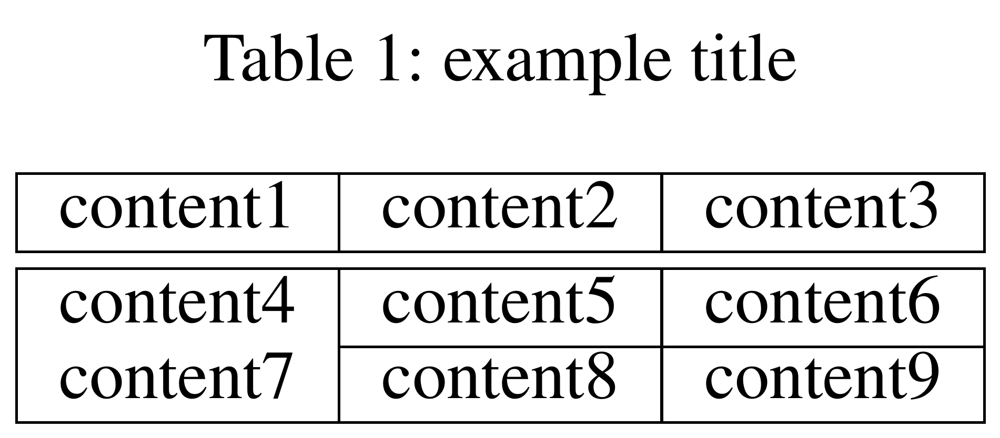

## 合并行列

```latex
\usepackage{multirow}		% 支持合并行
```

```latex
\begin{table}
\centering
\caption{example title}
\begin{tabular} {|c|c|c|}
\hline
content1        & \multicolumn{2}{c|}{content2} \\
\hline\hline
\multirow{2}{*}{content4} & content5 & content6 \\
\cline{2-3}
                          & content8 & content9 \\
\hline
\end{tabular}
\end{table}
```

说明：

合并列：`\multicolumn{2}{c|}{content}` 合并多列单元格，其中 `2` 指定合并的列数，`c|` 指定合并单元格后的对齐方式 `l/c/r` 以及绘制单元格的竖线，`content` 为单元格内容。

合并行：`\multirow{2}{*}{content}` 合并多行单元格（需要宏包 `multirow`），其中 `2` 指定合并的行数，`*` 指定合并单元格后的宽度为自然宽度，`content` 为单元格内容。

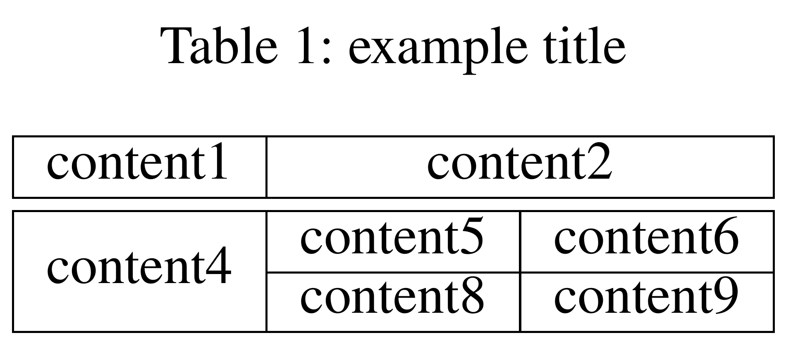

## 三线表

```latex
\usepackage{booktabs}		% 支持三线表
```

```latex
\begin{table}
\centering
\caption{example title}
\begin{tabular} {ccc}
\toprule		% 第一条线
content1 & content2 & content3 \\
\midrule		% 第二条线
%\addlinespace	% 增行间距
content4 & content5 & content6 \\
\cmidrule{2-3}
content7 & content8 & content9 \\
\bottomrule		% 第三条线
\end{tabular}
\end{table}
```

说明：`booktabs` 宏包提供了 `\toprule`、`\midrule`、`\bottomrule` 命令用以绘制三线表的三条线，此外也提供了和 `cline` 命令功能相似的 `cmidrule` 命令，以及 `\addlinespace` 命令用于增加行间距。

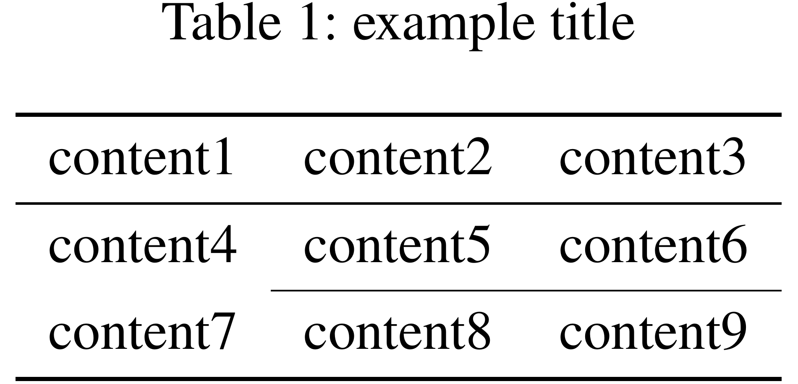

## 模板表

对于定量数值可以将其中的最优值（best results）和次优值（second-best results）标注出来，标注方式：

（a）加粗 `\textbf{best}` 与下划线 `\underline{second-best}`。

```latex
Bold denotes the best result, Underline denotes the second-best result.

The \textbf{best} and the \underline{second-best} results are highlighted/marked/shown in bold and underlined, respectively (the same applies to subsequent tables)/(ditto for subsequent tables).
```

（b）红色字体 `\textcolor{red}{best}` 与蓝色字体 `\textcolor{blue}{second-best}`。

```latex
\usepackage{xcolor} % 也可以导入 \usepackage[table]{xcolor}
```

```latex
The \textcolor{red}{best} and \textcolor{blue}{second-best} results are marked in red and blue, respectively.
```

（c）红色背景 `\colorbox{red!26}{best}` 与橙色背景 `\colorbox{orange!30}{second-best}`。

```latex
\usepackage{xcolor} % 也可以导入 \usepackage[table]{xcolor}
```

```latex
The \colorbox{red!26}{best}, \colorbox{orange!30}{second-best}, and \colorbox{yellow!36}{third-best} results are highlighted in red, orange, and yellow backgrounds, respectively.
```

（d）红色单元格 `\cellcolor{red!26}best` 与橙色单元格 `\cellcolor{orange!30}second-best`。**只能在表格内使用**。

```latex
\usepackage[table]{xcolor} % 不能只导入 \usepackage{xcolor}
```

```latex
The best, second-best, and third-best results are highlighted in red, orange, and yellow backgrounds, respectively.
```

备注：除（a）以外，第（b）（c）（d）种需要导入对应的宏包：`\usepackage{xcolor}`、`\usepackage[table]{xcolor}`。一些期刊/会议（e.g. AAAI）可能会要求论文中的文本内容不能使用颜色字体，此时推荐（a）方式。

> AAAI Press Anonymous Submission Instructions for Authors Using LaTeX:
> **Text**  In addition, you may not use color in the text.
> **Using Color.** Use of color is restricted to figures only. ... It may never be used for any portion of the text of your paper.

下面给出若干张简洁的模板表格，内容标注方式可以灵活更改：

（1）

```latex
\usepackage{multirow}		% 支持合并行
\usepackage{booktabs}		% 支持三线表
\usepackage[table]{xcolor}	% 支持颜色表
```

```latex
\begin{table}
\centering					% 表格居中
\small						% 设置字号 (默认 10pt 时, \small 为 9pt)
\setlength{\tabcolsep}{1mm}	% 设置列间距
%\resizebox{\textwidth}{!}{
\begin{tabular}{l|ccc|ccc}
\toprule					% 第一条线
\multirow{2}{*}{Method} & \multicolumn{3}{c|}{Dataset1} & \multicolumn{3}{c}{Dataset2} \\
        & PSNR & SSIM & COS    & PSNR & SSIM & COS \\
\midrule					% 第二条线
Method1	& 17.344 & 0.878 & 0.793  & 15.328 & 0.865 & 0.924 \\
Method2	& 29.465 & 0.838 & 0.250  & 22.796 & 0.820 & 0.296 \\
Method3	& 16.602 & 0.720 & 0.141  & 15.376 & 0.709 & 0.183 \\
\rowcolor{gray!30}			% 设置行颜色: 灰色, 透明度30
Ours    & 32.504 & 0.945 & 0.780  & 31.569 & 0.972 & \cellcolor{red!30}0.925 \\	% 设置单元格颜色
\bottomrule					% 第三条线
\end{tabular}
%}
\vspace{-1mm}				% 设置纵向间距
\caption{table name}		% 设置表格标题 (这里是表格下方写标题)
\label{label name}			% 设置表格标签 (供交叉引用)
\vspace{-1mm}				% 设置纵向间距
\end{table}
```

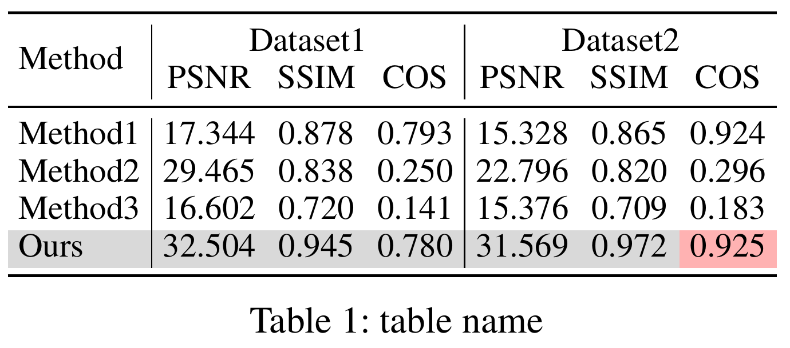

（2）

```latex
\usepackage{multirow}		% 支持合并行
\usepackage{booktabs}		% 支持三线表
\usepackage[table]{xcolor}	% 支持颜色表
```

```latex
\begin{table}
\centering					% 表格居中
\small						% 设置字号 (默认 10pt 时, \small 为 9pt)
\setlength{\tabcolsep}{1mm}	% 设置列间距
%\resizebox{\textwidth}{!}{
\begin{tabular}{lcccccc}
\toprule					% 第一条线
\multirow{2}{*}{Method} & \multicolumn{3}{c}{Dataset1} & \multicolumn{3}{c}{Dataset2} \\
\cmidrule{2-7}				% 跨越指定列的横线
        & PSNR & SSIM & COS    & PSNR & SSIM & COS \\
\midrule					% 第二条线
Method1	& 17.344 & 0.878 & 0.793  & 15.328 & 0.865 & 0.924 \\
Method2	& 29.465 & 0.838 & 0.250  & 22.796 & 0.820 & 0.296 \\
Method3	& 16.602 & 0.720 & 0.141  & 15.376 & 0.709 & 0.183 \\
\rowcolor{gray!30}			% 设置行颜色: 灰色, 透明度30
Ours    & 32.504 & 0.945 & 0.780  & 31.569 & 0.972 & \cellcolor{red!30}0.925 \\	% 设置单元格颜色
\bottomrule					% 第三条线
\end{tabular}
%}
\vspace{-1mm}				% 设置纵向间距
\caption{table name}		% 设置表格标题 (这里是表格下方写标题)
\label{label name}			% 设置表格标签 (供交叉引用)
\vspace{-1mm}				% 设置纵向间距
\end{table}
```

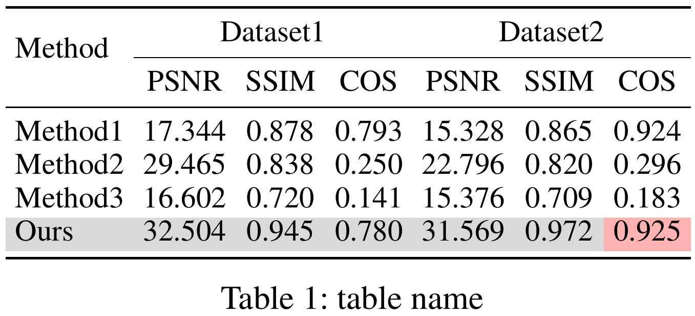

（3）

```latex
\usepackage{multirow}		% 支持合并行
\usepackage[table]{xcolor}	% 支持颜色表
```

```latex
\begin{table}
\centering					% 表格居中
\small						% 设置字号 (默认 10pt 时, \small 为 9pt)
\setlength{\tabcolsep}{1mm}	% 设置列间距
%\resizebox{\textwidth}{!}{
\begin{tabular}{|l||c|c|c||c|c|c|}
\hline						% 单横线
\multirow{2}{*}{Method} & \multicolumn{3}{c||}{Dataset1} & \multicolumn{3}{c|}{Dataset2} \\
\cline{2-7}					% 跨越指定列的单横线
        & PSNR & SSIM & COS    & PSNR & SSIM & COS \\
\hline\hline				% 双横线
Method1	& 17.344 & 0.878 & 0.793  & 15.328 & 0.865 & 0.924 \\
Method2	& 29.465 & 0.838 & 0.250  & 22.796 & 0.820 & 0.296 \\
Method3	& 16.602 & 0.720 & 0.141  & 15.376 & 0.709 & 0.183 \\
\hline\hline				% 双横线
\rowcolor{gray!30}			% 设置行颜色: 灰色, 透明度30
Ours    & 32.504 & 0.945 & 0.780  & 31.569 & 0.972 & \cellcolor{red!30}0.925 \\	% 设置单元格颜色
\hline						% 单横线
\end{tabular}
%}
\vspace{-1mm}				% 设置纵向间距
\caption{table name}		% 设置表格标题 (这里是表格下方写标题)
\label{label name}			% 设置表格标签 (供交叉引用)
\vspace{-1mm}				% 设置纵向间距
\end{table}
```

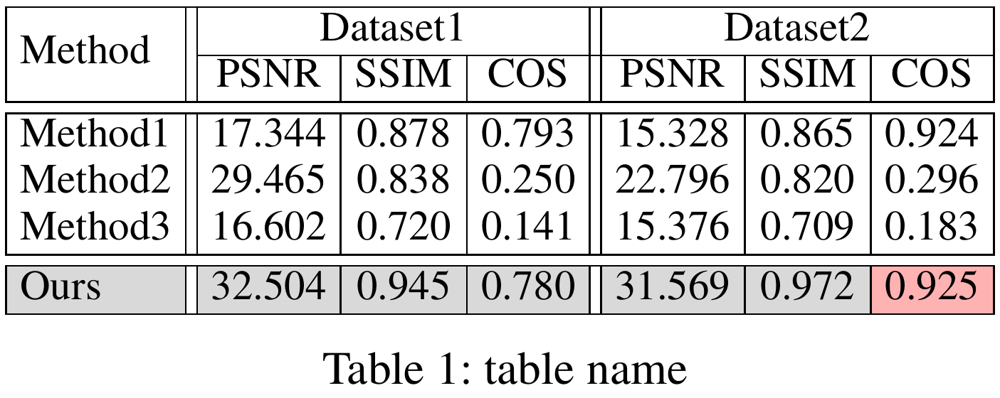

## 附录：设置大小

方式一：各列单独指定列宽，但是不好控制对齐。

```latex
\begin{table}
\centering
\begin{tabular}{|p{1cm}|p{1cm}|}	% 设置各列列宽
\hline
\multicolumn{1}{|c|}{col1} & \multicolumn{1}{c|}{col2} \\	% 标题行居中
\hline
1 & 2 \\	% 其他行默认是左对齐
3 & 4 \\	% 其他行默认是左对齐
\hline
\end{tabular}
\end{table}
```

方式二：通过**调整列间距**结合**调整字号**来控制表格大小。

```latex
\small						% 设置字号
\setlength{\tabcolsep}{1mm}	% 设置列间距
```

```latex
\begin{table}
\centering
\small						% 设置字号
\setlength{\tabcolsep}{1mm}	% 设置列间距
\begin{tabular}{|c|c|}
\hline
col1 & col2 \\
\hline
1 & 2 \\
3 & 4 \\
\hline
\end{tabular}
\end{table}
```

说明：当表格过宽时，可以通过缩小列间距来控制表格的宽度；如果此时表格依然过宽，可以通过再调小字号控制表格的宽度，其中小字号有（由小到大）：`\tiny`、`\scriptsize`、`footnotesize`、`\small`。

注意：通过主动设置字号的方式不能保证表格的宽度。

方式三：通过**调整列间距**结合**对象缩放**来控制表格大小（推荐）。

```latex
\setlength{\tabcolsep}{1mm}	% 设置列间距
\resizebox{<宽度>}{<高度>}{<内容>}
```

```latex
\begin{table}
\centering
\setlength{\tabcolsep}{1mm}	% 设置列间距
\resizebox{\textwidth}{!}{
\begin{tabular}{|c|c|}
\hline
col1 & col2 \\
\hline
1 & 2 \\
3 & 4 \\
\hline
\end{tabular}}
\end{table}
```

说明：`\resizebox{\textwidth}{!}{...}` 缩放至 `\textwidth` 宽度、自适应高度，即保持宽高比进行缩放。当表格过宽时，如果只使用 `\resizebox` 虽然会让表格宽度合适，但是表格内容会保持原始的列间距，从而导致字号自动变得非常小。因此，需要设置较小的列间距来保证表格宽度合适的同时表格内容字号尽可能的大（清晰）。

注意：对于任意一张表格，如果只设置列间距，可能会出现两种结果：（1）表格过宽，（2）表格过窄。对于前者，对表格进行上面的缩放会自动调小字号；对于后者，对表格进行上面的缩放会自动调大字号。

## 附录：并排排版（适用于图和表）

```latex
\begin{table}[t]
\centering
\begin{minipage}[b]{0.49\textwidth}
\centering
图表或表格内容
% \includegraphics[width=\textwidth]{imgname}	% \textwidth=0.49\textwidth
% \begin{tabular} ...
\caption{}	% 标题
\label{}	% 标签
\end{minipage}%
\hfill
\begin{minipage}[b]{0.49\textwidth}
\centering
图表或表格内容
% \includegraphics[width=\textwidth]{imgname}
% \begin{tabular} ...
\caption{}	% 标题
\label{}	% 标签
\end{minipage}
\end{table}
```

说明：`[t]` 表示**浮动体**允许排版的位置为页面顶部，可选参数：`h/t/b/p/!` 分别代表当前位置、顶部、底部、单独成页、在决定位置时忽视限制。`[b]` 代表子图表的对齐方式为底部，可选参数：`t/c/b` 分别代表顶部、居中、底部，建议以 `\caption` 的位置为对齐方向，例如 `\caption` 位于子图表的下方则使用 `[b]` 让两个标题对齐，尤其在两者高度不同时。`0.49\textwidth` 代表子图表分配的宽度空间，确保所有子图表的总宽度不大于 `\textwidth`，当恰好等于 `\textwidth` 时，由于 `\end{minipage}` 和下一个 `\begin{minipage}` 之间存在换行符或者空格导致在排版时每个子图表之间存在空格，从而导致实际总宽度（包含空格的宽度）大于 `\textwidth`，从而导致后面的子图表掉到下一行，为了解决该问题，可以：

（1）直接手动删除 `\end{minipage}` 和下一个 `\begin{minipage}` 之间的换行符以及空格：

```latex
\end{minipage}\hfill \begin{minipage}[b]{0.5\textwidth}
```

（2）使用注释符号 `%` 将换行符和空格注释掉：

```latex
\end{minipage}%
\hfill
\begin{minipage}[b]{0.5\textwidth}
```

（3）减小每个子图表的宽度：减小 `\textwidth` 的系数。与前两种方法不同，在排版结果上，前两种可以直接消除不同图表之间的间距，而这种方法可能**引入多余的间距空白区域**，此时使用 `\hfill` 表示插入可伸缩的水平空白，以撑开空白的方式保证子图表分散在整行内。

```latex
\end{minipage}%
\hfill
\begin{minipage}[b]{0.49\textwidth}
```

# 公式

常用的数学宏包：

```latex
\usepackage{amsmath}	% 支持 align 环境
\usepackage{amssymb}	% 支持常用的数学符号, e.g. \mathbb{R}
```

## 行内公式

```latex
这是一个行内公式示例: $行内公式编辑处$
```

## 行间公式

```latex
\begin{equation}
行间公式编辑处, 自动编号
\end{equation}
```

```latex
\begin{equation}
行间公式编辑处, 取消编号 \notag
\end{equation}

\begin{equation*}
行间公式编辑处, 没有编号
\end{equation*}
```

## 多行公式对齐 - align 环境

单独成行的行间公式在 LaTeX 中由 **equation** 环境包裹。更多情况的是，我们需要罗列一系列公式，并令其按照等号对齐。目前最常用的是 **align** 环境，它将公式用【&】分隔为两部分并对齐。如果想对齐多列，则需要使用另一个【&】符号来标记一列的结束位置。

```latex
\usepackage{amsmath}
```

```latex
\begin{align}
x + y + z &= 0 \\
y - z &= 1
\end{align}
```

显示效果（每个公式后会有编号）：
$$
\begin{align}
x + y + z &= 0 \\
y - z &= 1
\end{align}
$$
注意：使用 align 环境书写多行公式时会自动给每行公式分配一个编号，想要一个公式组只留一个编号只能手动在指定行的末尾添加【\\nonumber】或【\\notag】取消编号，比较麻烦；而 equation 环境嵌套 aligned 环境，可实现一个公式组只编一个号：

```latex
\usepackage{amsmath}
```

```latex
\begin{equation}
\begin{aligned}
x + y + z &= 0 \\
y - z &= 1
\end{aligned}
\end{equation} 
```

# 参考文献

BibTeX 是最为流行的参考文献数据组织格式之一。

## BibTeX 文件

BibTeX 文件分为 **\.bib** 和 **\.bst** 文件。前者为 BibTeX 数据库，存储所有的参考文献条目；后者为 BibTeX 样式文件，用来管理参考文献在文中的写法。使用样式文件的方法是在源代码内添加（通常写在导言区，aaai26 为样式文件的名称，这里不要带 \.bst）：

```latex
\bibliographystyle{aaai26}
```

BibTeX 数据库文件（\.bib）的内容：

```latex
@inproceedings{<label>,
  title={xxx},
  author={xxx},
  booktitle={ECCV},
  year={xxxx},
  volume={},
  number={},
  pages={xxx--xxx},
  organization={Springer}
}
@article{<label>,
  title={xxx},
  author={xxx},
  journal={IEEE TPAMI},
  year={xxxx},
  volume={xx},
  number={x},
  pages={xxx--xxx},
  publisher={IEEE}
}
@article{<label>,
  title={xxx},
  author={xxx},
  journal={arXiv preprint arXiv:xxxx.xxxxx},
  year={xxxx}
}
```

备注：在 `@inproceedings` 中通常包含 `title`、`author`、`booktitle`、`year`；在 `@article` 中通常包含 `title`、`author`、`journal`、`year`、`volume`、`number`、`pages`。

使用数据库文件的方法是在源代码中正文区域对应位置需要列出参考文献条目的位置添加（aaai26 为数据库文件的名称，这里不要带 \.bib）：

```latex
\bibliography{aaai2026}
```

## BibTeX 排版

Step 1：准备 \.bib 和 \.bst 文件，和 LaTeX 源代码一般位于同一个目录下；

Step 2：在源代码中添加：

```latex
\bibliographystyle{aaai26}			% 通常放在导言区, aaai26 为 .bst 文件名
example content~\cite{<label>}		% 在正文中引用 .bib 中的参考文献
\bibliography{aaai2026}				% 在正文需要列出参考文献条目的地方, aaai26 为 .bib 文件名
```

Step 3：编译：

（1）使用 **pdflatex** 或 xelatex 等命令编译；

（2）使用 **bibtex** 命令编译，处理参考文献信息；

（3）使用 **pdflatex** 或 xelatex 等命令编译，在文章中列出相应的参考文献条目（对于在 \.bib 文件中但未在正文引用的参考文献条目不会列出）；

（4）使用 **pdflatex** 或 xelatex 等命令编译，在文章中生成正确的引用。

# 交叉引用

```latex
\label{label-name}	% 在被交叉引用处打标签
\ref{label-name}	% 在待交叉引用处生成引用编号
```

注意：这里的**编号**和 `label-name` 无关，和 `\label` 的位置有关。生成交叉引用需要多次编译。在使用不记编号的命令形式（`\section*` 等）时不能使用 `\label` 命令，否则无法生成引用编号。

`\label` 命令的位置：

（1）**章节标题**。在章节标题命令 `\section` 等之后紧接使用。

（2）**图表标题**。在图表标题命令 `\caption` 之后紧接使用。

（3）**行间公式**。单行公式在公式内任意位置使用；多行公式在每一行公式的任意位置使用。

（4）**有序列表**。在每个 `\item` 命令之后、下一个 `\item` 命令之前的任意位置使用。

（5）**定理环境**。在定理环境内部任意位置使用。

# 附录1：页面参数

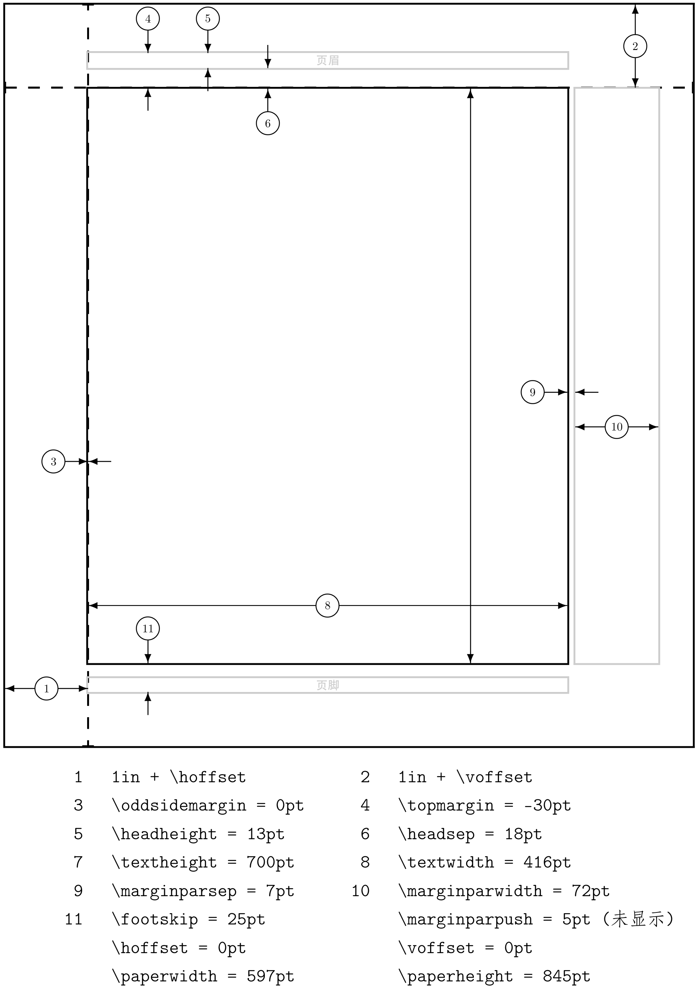

# 附录2：字号命令

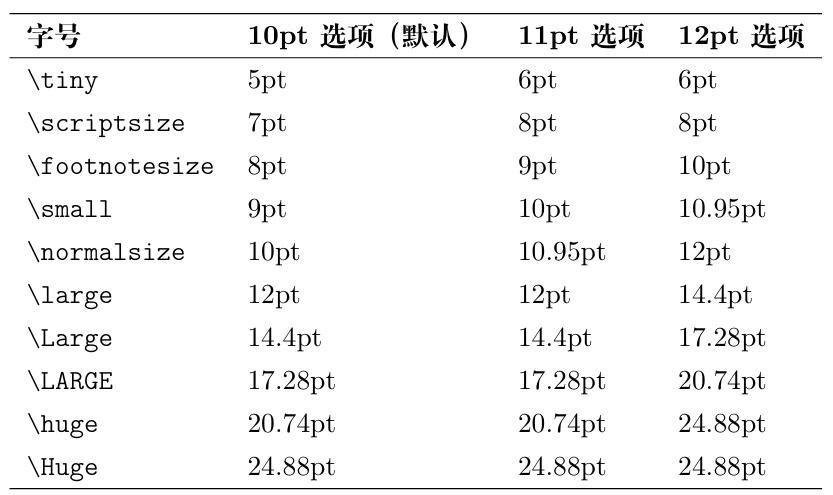
